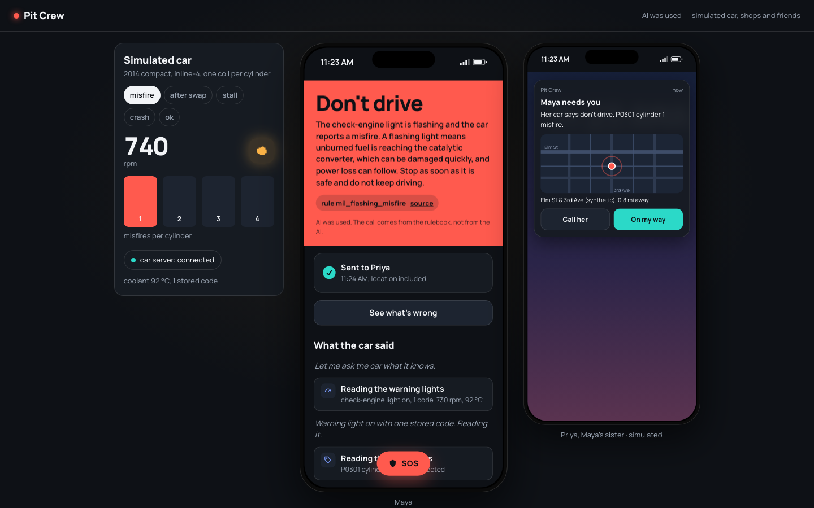
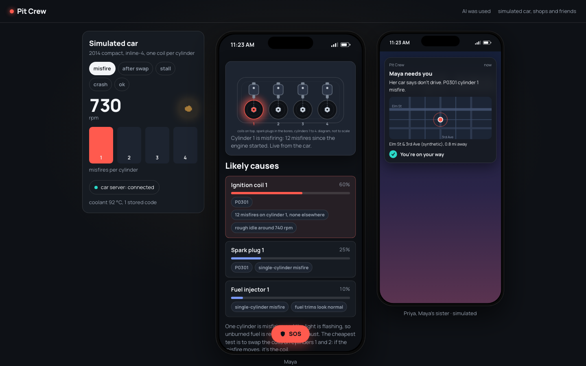
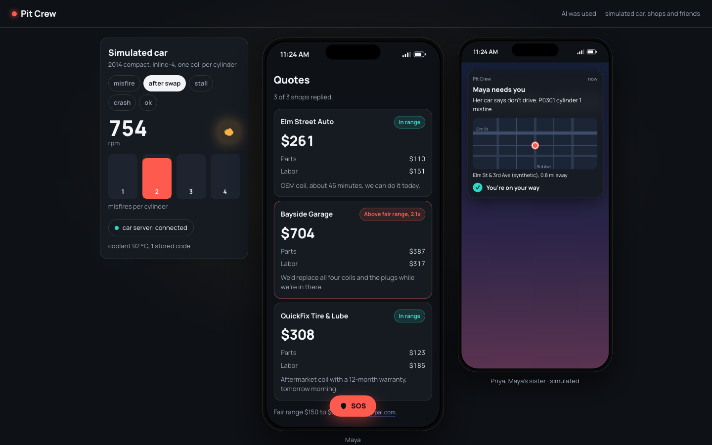
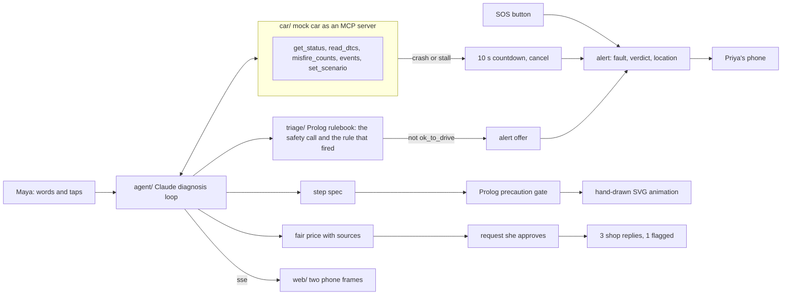

# Pit Crew

**When her car acts up, she is never stranded alone, and she never walks into a shop uninformed.**

Code with Claude: Women in AI hackathon, Nov 6 2026. Track: Safety and rights.

## The problem

Maya is 27, a home health aide, and her car is how she gets to the people she cares for. Tonight it is shaking at a red light and the check-engine light is flashing. Two things go wrong for women in that moment. The first is safety: being stuck with a car that should not be driven, alone, at night. The second is money: in a field study of auto repair quotes, women who did not mention a benchmark price were quoted significantly more than men, and the gap disappeared once a market price was mentioned ([Busse, Israeli and Zettelmeyer, NBER](https://www.nber.org/papers/w19154.pdf)).

Pit Crew talks to the car's own computer, makes the safety call from a checkable rulebook, tells her people where she is the moment it is not safe to drive, walks her through the cheapest test with an animated step, and sends her into the shop with the fault, her test result and the fair price.

Maya, the car, the shops and the friends are synthetic. The screen says so.

## Screens







## Demo video

VIDEO_LINK_HERE (under 3 minutes)

## How it works



- **Two input states.** *Watch* is observational: Pit Crew reads the car and alerts her without being asked. *Ask* is conversational and live: she tells it what is wrong in her own words, attaches a photo, and Claude answers, reads the car mid-conversation when it needs to, and annotates the photo with numbered boxes.
- **The car is an MCP server.** `car/server.py` exposes the car's computer as tools over stdio. Any Claude client can talk to it: `claude mcp add car -- .venv/bin/python -m car.server`. In the demo the car is a mock with five scenarios (misfire before and after the coil swap, stall, crash, ok).
- **Claude questions the car like a mechanic.** The loop reads the warning lights and codes, then picks each next query from the evidence (misfire counts, freeze frame, fuel trims), ranks the causes and proposes the cheapest test that separates them, as a strict-schema step spec.
- **The rulebook makes the safety call, not Claude.** `triage/triage.pl` turns published warning-light guidance into Prolog rules, each cited to the text in `sources/`, with plunit tests. The UI shows the rule that fired and its source. Unknown critical signals count as unsafe.
- **Her people know.** The alert offer appears whenever the call is not "ok to drive". SOS is on every screen. A crash or stall from the car fires an alert after a 10-second countdown she can cancel. Location is optional, per alert and in settings. Her friend's phone shows the fault, the verdict and the pin.
- **Nothing is drawn that the rules did not check.** Each step is a spec; the Prolog gate checks its precautions; the animation is a hand-drawn SVG driven by that spec and the car's live misfire counts.
- **She walks in informed.** The request to the shops states the fault code, her test result and the fair price range with sources. She approves it before it is "sent". Three replies come back; the one above the fair range is flagged.

## Run it

```bash
python3 -m venv .venv && .venv/bin/python -m pip install fastapi 'uvicorn[standard]' anthropic mcp sse-starlette python-dotenv pytest httpx
cd web && npm install && cd ..
make dev        # backend on :8000, web on :5173
```

Optional: put `ANTHROPIC_API_KEY=...` in `.env` for the live diagnosis loop. Without it the loop replays a recorded transcript, but the car and the rulebook still run for real. `make smoke` runs the feature checks offline in under 90 seconds.

## How we used Claude

- `claude-opus-5-5` runs the diagnosis loop with tool use: the car's MCP tools, a `triage` tool that calls the Prolog rulebook, and a `propose_step` tool whose input schema is the step spec. Tool calls stream to the UI over SSE.
- `claude-opus-5-5` also runs the live Ask mode: vision on her photo, the same car tools, the triage tool, and an `annotate_photo` tool whose strict schema is a list of boxes in normalized coordinates that the UI draws over the photo.
- `claude-sonnet-5-5` renders an SVG only for a step the hand-drawn diagram cannot show, and only from a spec the gate approved; the SVG is sanitized and shown in a sandboxed iframe.
- Claude Code built this in one morning: one planning session that froze the contracts and the UX spec in `CLAUDE.md`, then six parallel lanes (car, triage, backend-diagnose, backend-safety, web-shell, web-diagnosis) with disjoint file ownership, and a smoke script that checks every feature by number.

## Safety and limits

- Synthetic data only. No real people, cars, shops or locations. Every screen says so.
- The drive / don't drive call comes from cited rules, not from the model, and the rule and source are shown. It is still not a substitute for a mechanic or roadside assistance; the app says to call emergency services for a crash.
- Alerts stay in the app in this demo. Nothing is sent to a real phone or shop.
- AI was used, and every result screen says so.
- Fair price ranges come from public sources listed on screen and may not match a specific car or region.

## Feature checks

See `../pit-crew-features.md` for the feature list with a check and expected output per feature; `smoke.py` runs them. Run `make smoke` and read the PASS lines.

## Team

Ashmita Dua, solo, with Claude Code.
