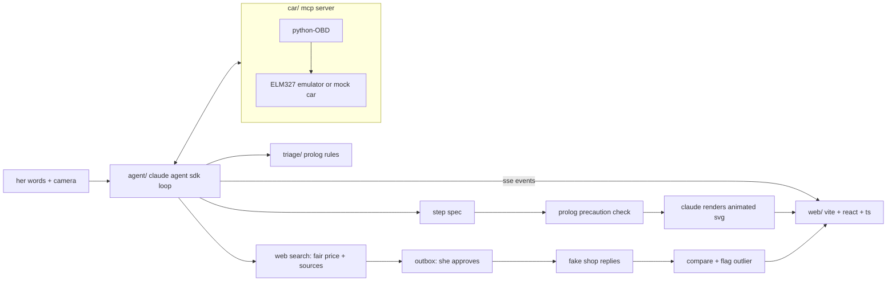

# pit crew: build plan

claude talks to her car's computer, makes the safety call with checked rules, animates her exact next step, and when it's a shop job she walks in knowing what's wrong and what it should cost.

- event: code with claude: women in ai hackathon, nov 6 2026
- track: economic mobility
- deadline: demo video + public github repo by **12:45**. feature freeze **12:00**. submit by **12:35**
- status: plan only. no code until hack time starts

---

## 1. why this exists

- car trouble is a financial shock, and for a lot of women the car is how they get to work.
- in a field study of auto repair quotes, women who did not mention a benchmark price were quoted more than men. the gap disappeared once a market price was mentioned ([busse, israeli, zettelmeyer](https://www.nber.org/papers/w19154.pdf)).
- pit crew makes her the informed caller every time, and walks her through the small fixes so she may not need a shop at all.

## 2. demo scenario (synthetic)

| | |
| --- | --- |
| persona | maya, 27, home health aide, needs the car for work tomorrow |
| car | 2014 compact, 1.8l inline-4, one ignition coil per cylinder (pick the exact model with the clearest public owner's manual) |
| symptom | shaking at idle, check-engine light flashing |
| car reports | `P0301` cylinder 1 misfire |
| cheapest test | swap the coils on cylinders 1 and 2 |
| after the swap | `P0302`: the misfire followed the coil, so it's the coil |
| ending a (diy) | part, price with source, animated replacement steps |
| ending b (shop) | three informed quote requests, replies compared, one flagged as inflated |

the car, the shops and the persona are simulated. say so on screen.

## 3. user flow

1. she says what's happening: "it's shaking and the light is blinking".
2. the car connects through the mcp server. obd reports the light is on and the stored codes. whether it's flashing comes from her (or the camera on the dash).
3. claude queries the car: codes, status, fuel trims, misfire counts. each next query is picked from the evidence, not a fixed tree.
4. prolog triage makes the call: `stop_now` / `short_trip_only` / `ok_to_drive`, with the rule that fired. unknown critical signals count as unsafe.
5. claude ranks the causes (coil, plug, injector, vacuum leak, compression) and proposes the cheapest test that tells them apart.
6. each step becomes a spec. prolog checks its precautions. claude renders the spec as an animated svg. the next step is prefetched.
7. she does the test. the car's data changes. the engine diagram moves the flicker. claude updates the diagnosis.
8. ending a or b. nothing leaves without her approval.

## 4. architecture



| part | stack | why over the alternative |
| --- | --- | --- |
| car/ | python, `obd`, `ELM327-emulator`, mcp python sdk (`mcp`, fastmcp) over stdio | a standalone mcp server means any claude client can talk to the car, not just our app |
| triage/ | swi-prolog + plunit, called via `swipl` subprocess, json out | the drive / don't drive call has to be checkable, and the rule that fired is the explanation |
| agent/ | `claude-agent-sdk`, fastapi + sse | real tool loop with mcp, web search and streaming without building a harness |
| web/ | vite + react + typescript | ts is home turf; animations render in a sandboxed iframe |
| animations | svg + css keyframes, no js | renders in an iframe with `sandbox` and no `allow-scripts` |

checked on pypi: `obd` 0.7.3 has `GET_DTC`, `STATUS`, `FREEZE_DTC`, fuel trims and mode 06 `MONITOR_MISFIRE_CYLINDER_1..12`. `ELM327-emulator` 4.0.0 has a `car` scenario, stored dtcs (empty by default, editable in a custom scenario) and mode 06 misfire responses for cylinders 1 to 4.

## 5. contracts (freeze first, change only here)

### car mcp tools

| tool | returns |
| --- | --- |
| `get_status()` | `{ "mil_on": true, "dtc_count": 1 }` |
| `read_dtcs()` | `[{ "code": "P0301", "desc": "cylinder 1 misfire detected" }]` |
| `read_pid(name)` | `{ "name": "LONG_FUEL_TRIM_1", "value": <number>, "unit": "percent" }` |
| `misfire_counts()` | `{ "1": <n>, "2": <n>, "3": <n>, "4": <n> }` |
| `set_scenario(name)` | demo only: `"before_swap"` or `"after_swap"` |

### triage result

```json
{
  "call": "stop_now | short_trip_only | ok_to_drive",
  "rule": "mil_flashing_misfire",
  "why": "plain-language reason",
  "cite": { "label": "owner's manual, warning lights", "url": "...", "source_id": "sources/manual-warning-lights.md" },
  "unknowns": ["is the light flashing or steady?"]
}
```

### step spec

```json
{
  "id": "swap-coils-1-2",
  "title": "swap the coils on cylinders 1 and 2",
  "parts": ["coil 1", "coil 2", "coil connectors", "coil bolts"],
  "actions": [{ "verb": "unclip", "target": "coil 1 connector" }],
  "tools": ["socket from the manual"],
  "precautions": ["engine_off", "engine_cool"],
  "expect": "misfire moves to cylinder 2"
}
```

### quote

```json
{
  "shop": "synthetic shop name",
  "total_usd": "<number>",
  "parts_usd": "<number>",
  "labor_usd": "<number>",
  "fair_range_usd": ["<low>", "<high>"],
  "flag": "in_range | above_range",
  "sources": ["url"]
}
```

## 6. triage rules (draft from sources/ at hack time)

every rule cites owner's manual or manufacturer text in sources/. anything ambiguous goes to `triage/OPEN_QUESTIONS.md`, not into the rules.

| signal | call | note |
| --- | --- | --- |
| check-engine light flashing | `short_trip_only` or stricter, per the manual | severe misfire can damage the catalytic converter |
| check-engine light steady, drives normally | `ok_to_drive` | get it read soon |
| oil pressure warning | `stop_now` | |
| engine overheating | `stop_now` | |
| red brake warning | per the manual | |
| charging system warning | `short_trip_only` | |
| she can't tell if it's flashing | treat as flashing | unknown counts as unsafe |

## 7. animation pipeline

1. claude writes a step spec (strict tool schema).
2. prolog checks the precautions against the current state (engine off? cool?). if one fails, the ui shows what's missing and nothing gets drawn.
3. a second call (sonnet) renders the spec as one svg with css keyframes: schematic, labeled "diagram, not to scale", fixed viewBox, no external assets, no script.
4. strip `script`, `foreignObject` and external hrefs, then render in a sandboxed iframe.
5. cache by spec hash. prefetch the next step while she works. once the demo steps look right, pin those renders.
6. the engine diagram with the flickering cylinder is not generated. the web lane hand-builds it and drives it from `misfire_counts`. reliability first.

## 8. lanes and tasks

each box is a done-check. commit after each one.

### car lane: `claude -w car -n car --effort xhigh --permission-mode acceptEdits`

- [ ] emulator running (`python3 -m elm -s car`), python-OBD connected, `read_dtcs` returns `P0301` from a custom scenario
- [ ] `set_scenario("after_swap")`: `read_dtcs` returns `P0302`, misfire counts move to cylinder 2
- [ ] fastmcp server exposes the five tools; `claude mcp add` it locally and call each one from claude code
- [ ] triage rules with cite facts, plunit green, `triage` returns the contract json
- [ ] `make smoke`: scenario end to end, asserts the triage call, the swap step and the moved misfire

fallbacks: emulator wiring takes more than 20 minutes, switch to a mock car behind the same tools. editing mode 06 hex responses gets fiddly, serve `misfire_counts` from the mock layer and keep the codes on the emulator.

### agent lane: `claude -w agent -n agent --permission-mode acceptEdits`

- [ ] agent server: fastapi + sse, agent sdk with the car server as an mcp server, events streamed to the ui (tool calls, triage, diagnosis board updates)
- [ ] system prompt: reason like a mechanic, call triage before proposing any step, choose the cheapest test that separates the top causes, never state a price without a source
- [ ] step spec tool, precaution check, render call, cache and prefetch
- [ ] fair price via web search with urls kept (cached copy in data/ in case venue wifi drops), outbox that waits for approval, fake inbox replies, comparison and flag
- [ ] stretch: eval-builder agent, 20 synthetic scenarios, claude-alone triage vs prolog triage, `eval/results.md`

### web lane: `claude -w web -n web --permission-mode acceptEdits`

- [ ] fixtures from the contracts, five-panel layout
- [ ] safety banner (biggest thing on screen), diagnosis board (causes ranked with evidence), engine diagram (flicker from counts), step player (sandboxed iframe), quote inbox (flag + sources)
- [ ] the cylinder 1 to 2 transition is smooth and obvious
- [ ] sse hookup, "simulated car" label, ai notice on every result
- [ ] demo-tester agent over the full path

### teammate (if any)

- [ ] sources/: owner's manual warning-light pages and coil steps for the demo car, fair-price pages, url on line 1
- [ ] persona and shop replies in data/
- [ ] `/demo-script`, README skeleton, pitch rehearsal

## 9. timeline

| when | outcome |
| --- | --- |
| kickoff + 0:10 | repo bootstrapped and public, plan approved, contracts frozen in CLAUDE.md |
| kickoff + 0:45 | every lane has its first done-check green |
| 11:30 | lanes merged to main, `make smoke` green, demo-tester run |
| 12:00 | feature freeze |
| 12:00 to 12:20 | `/demo-script`, record two takes, `/ship-check` |
| 12:35 | repo + video submitted |

## 10. scope

**mvp**
- [ ] car mcp server with the before/after swap scenario
- [ ] prolog triage, cited, tested
- [ ] diagnosis loop with tool calls visible
- [ ] one animated step (the coil swap) from a checked spec
- [ ] engine diagram driven by live misfire counts
- [ ] fake inbox: three quotes, one flagged, fair price with sources
- [ ] `make smoke` green on main

**stretch** (only if mvp is green by 11:30)
- [ ] camera check of the engine bay (creative commons photo)
- [ ] part price and nearby stock
- [ ] voice in and out
- [ ] 20-case eval

**cut on sight:** real emails to shops, accounts, a second engine layout, anything that needs a real car.

## 11. risks and fallbacks

| risk | fallback |
| --- | --- |
| emulator wiring | mock car behind the same tools |
| mode 06 responses are fiddly | mock layer serves misfire counts |
| animation latency | prefetch, cache, pin the demo renders |
| animation shows something wrong | schematic only, labeled, drawn from a checked spec; camera confirms the real part |
| venue wifi or web search fails | cached fair-price sources in data/ |
| api credits haven't landed | claim at kickoff, ask a mentor immediately |
| running out of time | cut camera, then voice, then eval |

## 12. demo beats (full script lives in the playbook)

1. maya's problem and the quote study (0:15)
2. car connects, tool calls stream, safety call (0:30)
3. flickering cylinder and the animated coil swap (0:25)
4. the swap, the flicker moves (0:20)
5. informed quotes, one flagged (0:30)
6. how it's built, close: "she walks into the shop knowing what's wrong and what it should cost" (0:30)

## 13. rules we're following

- public or synthetic data only. no real personal data
- nothing built before kickoff; this plan is the only thing written ahead
- every result screen says ai was used; she approves anything sent
- the safety call comes from rules, not from claude

## 14. open questions

- [ ] mentor: today's rubric, video length limit, public repo required, prior open-source code allowed?
- [ ] which demo car has the clearest public manual pages for warning lights and coil replacement?
- [ ] can the emulator hold a custom scenario with `P0301` and editable mode 06 responses? (first 20 minutes of the car lane)
- [ ] standalone stdio mcp server (reusable, better pitch) vs in-process sdk server (simpler)? default: standalone

## sources

- [repairing the damage: the effect of price expectations on auto-repair price quotes](https://www.nber.org/papers/w19154.pdf), busse, israeli, zettelmeyer
- [obd on pypi](https://pypi.org/project/obd/), [ELM327-emulator on pypi](https://pypi.org/project/ELM327-emulator/), [claude-agent-sdk on pypi](https://pypi.org/project/claude-agent-sdk/)
- [claude code power user tips](https://support.claude.com/en/articles/14554000-claude-code-power-user-tips)
